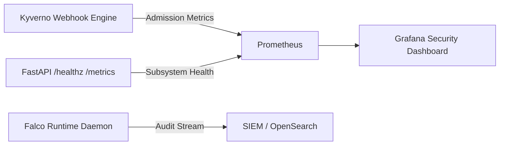

# Supply Chain Security Telemetry & Metrics Dashboard

## Executive Summary
This document defines the operational security metrics, telemetry exporters, and Prometheus alerting thresholds implemented across the SLSA Level 3 pipeline and Kubernetes runtime.

## Key Performance Indicators (KPIs)
1. **Provenance Verification Rate**: 100% of production container images must possess cryptographic Cosign and Rekor proofs before pod scheduling.
2. **Admission Controller Latency**: P99 Kyverno webhook evaluation latency under 50ms.
3. **Zero Vulnerability Tolerance**: 0 Critical and 0 High CVEs allowed in release artifacts.
4. **SBOM Freshness**: Real-time CycloneDX and SPDX catalogs generated synchronously on every merged PR.

## Telemetry Pipeline Architecture

## Alerting Thresholds
| Metric | Warning Threshold | Critical Threshold | Action |
| :--- | :--- | :--- | :--- |
| `kyverno_policy_execution_duration_seconds` | > 30ms | > 50ms | Scale webhook replicas |
| `sigstore_verification_failures_total` | > 0 | > 5 | Block deployment pipeline |
| `unauthorized_egress_attempts_total` | > 0 | > 1 | Terminate offending pod |
