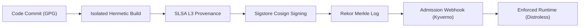

# Zero Trust Immutable Container Lifecycle & Provenance Enforcement

## Architectural Lifecycle Stages
Every production container artifact progresses through an immutable lifecycle:

## Key Invariants
1. **Never Trust Tags**: Images are referenced solely by immutable cryptographic SHA-256 digests.
2. **Keyless Ephemeral Identity**: Cosign leverages Fulcio OIDC short-lived certificates tied to GitHub Actions OIDC claims.
3. **Transparency Logging**: Every signing event publishes an immutable inclusion proof to Sigstore Rekor before artifact promotion.
